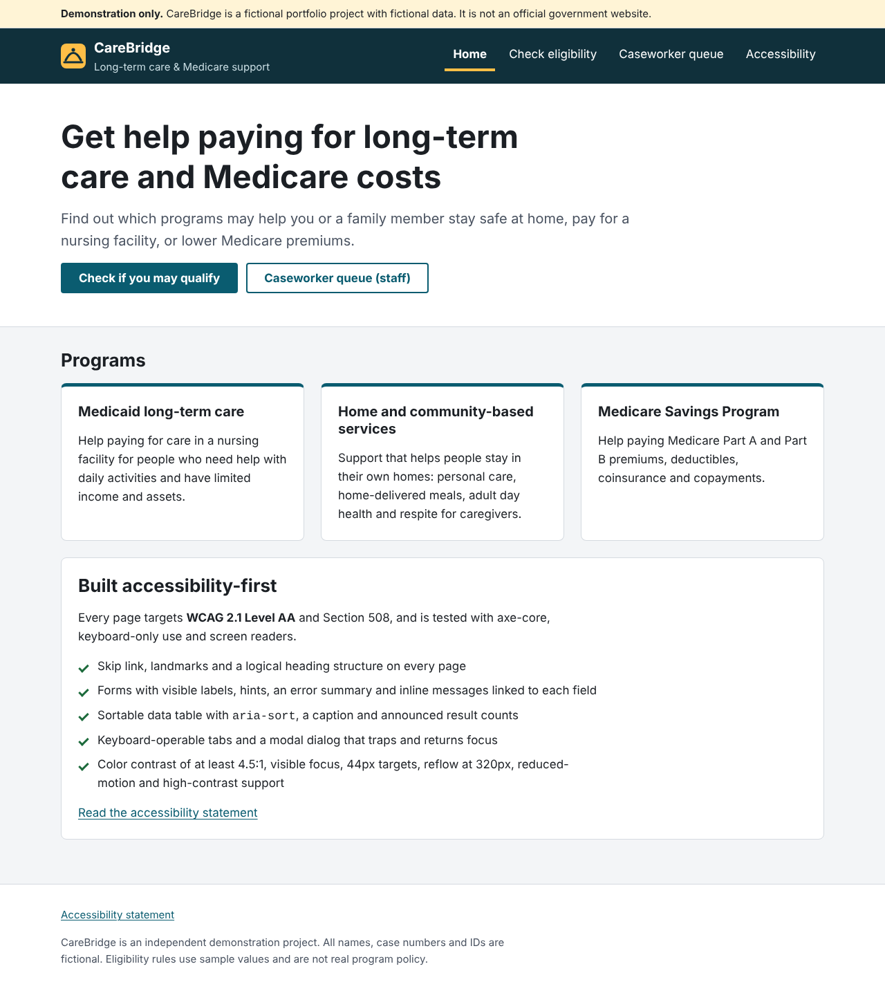
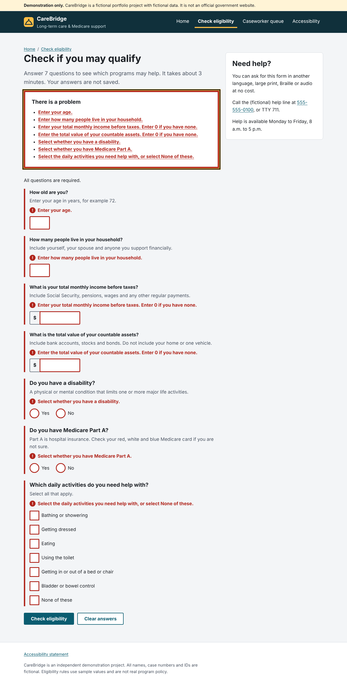
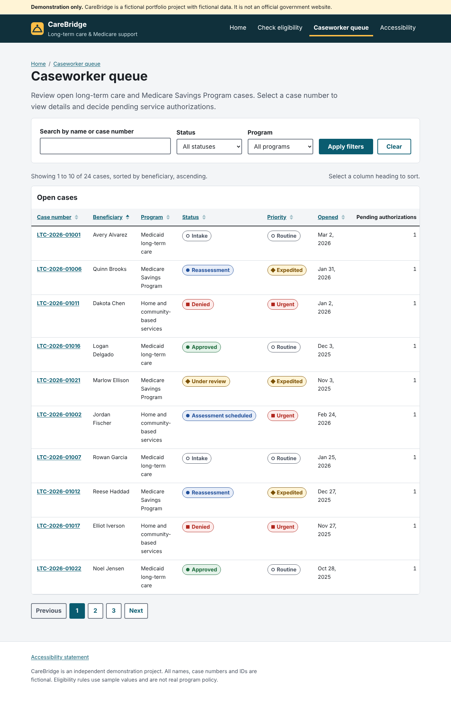
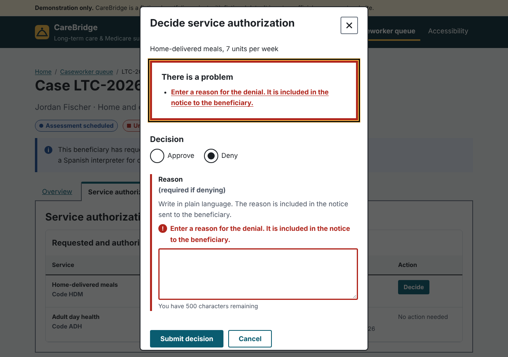
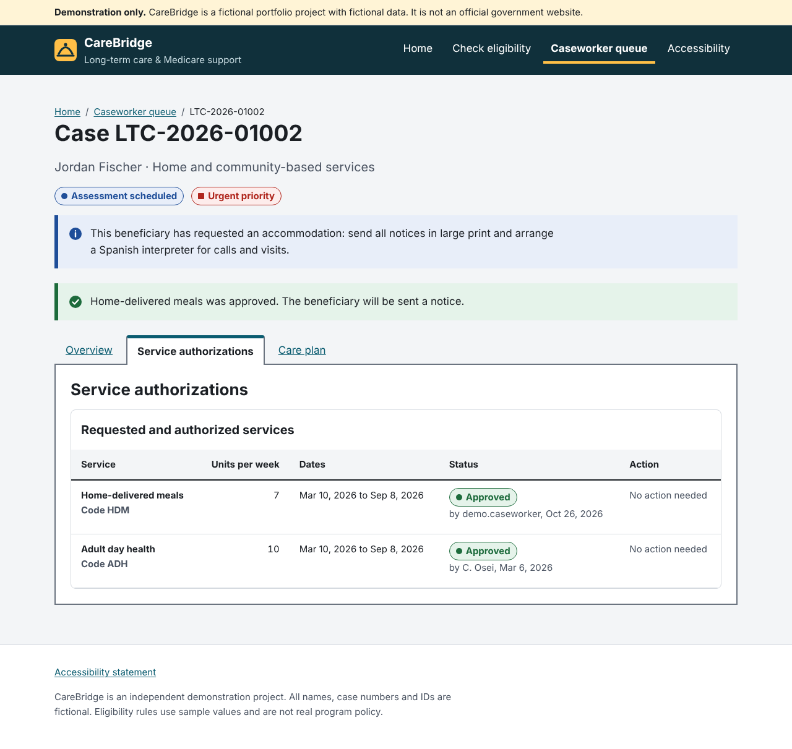

# CareBridge: Accessible Long-Term Care & Medicare Support Portal

An independent portfolio project showing **full-stack .NET development with accessibility as a core requirement**, set in the Medicaid and Medicare long-term care domain.

> **Demonstration only.** All names, case numbers, Medicaid IDs and counties are fictional. Eligibility thresholds are sample values, not real program policy. This repository contains no client or agency code.

| | |
|---|---|
| **Backend** | C# / ASP.NET Core 8 Web API, EF Core 8 (SQL Server or in-memory), middleware, ProblemDetails, Data Protection encryption |
| **Front end** | Semantic HTML5, Sass design system ("Beacon"), vanilla JavaScript ES modules, no framework required |
| **Accessibility** | WCAG 2.1 AA / Section 508. axe-core + Playwright tests in CI, manual JAWS / NVDA / keyboard test plan |
| **Data** | SQL Server schema, indexes, constraints, stored procedures, reporting view |
| **DevOps** | GitHub Actions and Azure DevOps (`azure-pipelines.yml`) pipelines with an accessibility gate |



---

## What it does

**Public eligibility pre-screener** (`/eligibility.html`)
Seven plain-language questions estimate whether someone may qualify for Medicaid long-term care, home and community-based services (HCBS), or a Medicare Savings Program. It demonstrates an accessible form end to end: client validation, server validation, error summary and results announcement.

**Caseworker queue** (`/cases.html`)
Search, filter, sort and page through cases. Sortable column headers expose `aria-sort`, result counts are announced, and filter state lives in the URL.

**Case detail** (`/case.html?id=1`)
Tabs (Overview, Service authorizations, Care plan), a masked Medicaid ID, a prominent **communication-accommodation alert** (large print, Braille, interpreter), and a modal dialog for approving or denying a service authorization with an audit trail.

| Error summary and inline errors | Sortable, filterable queue |
|---|---|
|  |  |

| Decision dialog (validation) | Confirmation and focus management |
|---|---|
|  |  |

---

## Accessibility highlights

See **[ACCESSIBILITY.md](ACCESSIBILITY.md)** for the full WCAG 2.1 AA criteria mapping, with file references and the manual test script.

- **Structure:** skip link, landmarks, one `h1` per page, logical headings, unique page titles, `lang`, breadcrumbs with `aria-current`.
- **Forms** ([`form-errors.js`](src/CareBridge.Api/wwwroot/js/a11y/form-errors.js)): visible labels, hints linked via `aria-describedby`, `fieldset`/`legend` for groups, an error summary that receives focus and links to each field, inline messages, `aria-invalid`, and an `Error:` page title prefix. Server `ValidationProblemDetails` are rendered the same way as client errors.
- **Status messages** ([`announcer.js`](src/CareBridge.Api/wwwroot/js/a11y/announcer.js)): persistent polite/assertive live regions for "results loaded", sort changes and save confirmations (SC 4.1.3).
- **Tabs** ([`tabs.js`](src/CareBridge.Api/wwwroot/js/a11y/tabs.js)): WAI-ARIA Authoring Practices pattern with roving `tabindex`, arrow keys, Home and End.
- **Dialog:** native `<dialog>` with `showModal()` (inert background, Escape to close), labelled, initial focus on the first field, and focus returned to the trigger.
- **Data table:** `caption`, `scope`, row headers, `aria-sort` on the active column, and a keyboard-scrollable labelled region for reflow.
- **Visual:** every color token is checked for contrast (lowest text pairing 5.7:1), a two-tone focus ring, 44px targets, reflow at 320px, `prefers-reduced-motion`, `forced-colors` (Windows High Contrast), and status shown by text and shape as well as color.
- **Screen-reader details:** masked IDs read as "ending in 4 8 2 1"; "Decide" buttons carry hidden context ("Decide on Respite care").

## Backend highlights

- **Clean layering:** controllers → services → EF Core `DbContext`; DTOs separate the API contract from entities.
- **Validation:** DataAnnotations plus `IValidatableObject` (for example, a denial requires a reason), returned as RFC 7807 `ValidationProblemDetails` keyed by field.
- **Security:** Medicaid IDs encrypted at rest with the **ASP.NET Core Data Protection API** (purpose-isolated keys) and only the last 4 stored for display; whitelist-validated sort parameters; a strict Content-Security-Policy (no inline script or style); security headers middleware.
- **Traceability:** correlation-ID middleware (sanitised against log injection) adds the ID to logs, responses, ProblemDetails and audit rows. Decisions write an audit entry in the same transaction.
- **Configurable rules:** eligibility thresholds bound from `appsettings.json` with the Options pattern; culture-safe currency formatting.
- **Tests:** xUnit unit tests (rules, boundary values, encryption) and `WebApplicationFactory` integration tests through the full HTTP pipeline.

## Project structure

```
CareBridge.sln
├── src/CareBridge.Api/
│   ├── Controllers/          REST endpoints (eligibility, cases, decisions)
│   ├── Services/             Eligibility rules, case service, audit, current user
│   ├── Data/                 EF Core DbContext + fictional seed data
│   ├── Domain/ Dtos/         Entities and API contracts
│   ├── Middleware/           Correlation ID, security headers
│   ├── Security/             PII encryption and masking
│   ├── Styles/               Sass design system (tokens, base, layout, components)
│   └── wwwroot/              HTML pages, compiled CSS, JS modules (a11y utilities + pages)
├── tests/
│   ├── CareBridge.Tests/     xUnit unit + integration tests
│   └── accessibility/        Playwright + axe-core WCAG 2.1 AA tests
├── database/                 SQL Server schema, stored procedures, reporting view
├── docs/                     Design system guide, screenshots
├── .github/workflows/ci.yml  GitHub Actions
└── azure-pipelines.yml       Azure DevOps pipeline
```

## Run it locally

Requires the [.NET 8 SDK](https://dotnet.microsoft.com/download). No database is needed: without a connection string the app uses an in-memory database seeded with fictional data.

```bash
dotnet run --project src/CareBridge.Api
# open http://localhost:5080     (Swagger UI: http://localhost:5080/swagger)
```

**Tests**

```bash
dotnet test                         # unit + integration tests
npm install                         # Sass + Playwright + axe-core
npx playwright install chromium
npm run test:a11y                   # starts the app and runs the accessibility suite
```

**Sass:** `npm run sass:build` (or `sass:watch`). The compiled `wwwroot/css/site.css` is committed so the app runs without Node.

**SQL Server (optional):** run `database/001_schema.sql` and `002_stored_procedures.sql`, then set `ConnectionStrings:CareBridge` (for example with `dotnet user-secrets`).

## API

| Method | Route | Purpose |
|---|---|---|
| `POST` | `/api/eligibility/screen` | Screen answers against sample program rules |
| `GET` | `/api/cases?search=&status=&program=&sort=&dir=&page=&pageSize=` | Filtered, sorted, paged queue |
| `GET` | `/api/cases/{id}` | Case detail with a masked beneficiary ID |
| `POST` | `/api/cases/{caseId}/authorizations/{id}/decision` | Approve or deny (409 if already decided) |
| `GET` | `/health` | Health check |

## Scope notes

To keep the sample focused, staff sign-in is represented by a fixed demo user (`ICurrentUser`); in production this would be Entra ID / OIDC with role-based policies on the caseworker endpoints. Data Protection keys would be persisted to Azure Key Vault (or AWS KMS) rather than the local key ring.

## License

[MIT](LICENSE)
